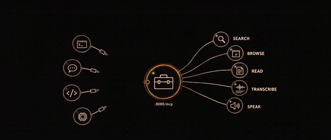

# Agentic Toolbox MCP

**Give all your AI agents the same tools. Know when those tools break.**

27 tools behind one self-hosted MCP endpoint. Web search, browser automation, document processing, video, transcription, and speech, with functional health monitoring built in.

[](https://github.com/ruashots/agentic-toolbox-mcp/actions/workflows/ci.yml)
[](LICENSE)
[](#whats-included)

<a href="docs/media/toolbox-hero.mp4"></a>

Connect Claude Code, Codex, local-LLM applications, or your own MCP clients. Run the toolbox once, share its capabilities across agents, and extend it without adding another MCP connection to every client.

## What's included

| Capability | Powered by |
|---|---|
| Web search across multiple engines | SearXNG |
| JavaScript-rendered pages → Markdown | Crawl4AI |
| Browser automation, forms, screenshots, sessions | Camoufox |
| Documents, spreadsheets, presentations → Markdown | MarkItDown |
| PDF text extraction | Stirling-PDF |
| Video metadata, captions, media downloads | yt-dlp |
| Local speech transcription | whisper.cpp |
| Text-to-speech and voice cloning | OmniVoice |
| Functional health monitoring | Built-in watcher |

10 gateway tools + 17 browser tools. All accessible through one MCP endpoint.

Agents can also access authorized local-network services, not just public websites.

## More than tools that happen to be running

A healthy container doesn't guarantee a working tool.

The built-in watcher performs real operations: searching, browsing, reading pages, converting documents, and processing audio.

When a tool fails, the gateway can tell your agent whether the failure is known, when it started, and what alternative to try.

No more mistaking a running service for a functioning one.


*Captured from real tool calls using [gateway/demo.py](gateway/demo.py).*

## Get started

Requires x86-64 Linux or WSL2, Docker Compose v2, 8 GB RAM, and 55 GB free disk. No GPU or commercial API keys required for the bundled services.

```bash
git clone https://github.com/ruashots/agentic-toolbox-mcp.git
cd agentic-toolbox-mcp
docker compose up -d --build
```

Connect Claude Code:

```bash
claude mcp add --transport http --scope user toolbox http://localhost:8000/mcp
```

Or Codex:

```bash
codex mcp add toolbox --url http://localhost:8000/mcp
```

Other MCP clients can connect using Streamable HTTP at `http://<server-address>:8000/mcp`.

Run the live demonstration:

```bash
docker exec tb-gateway python demo.py
```

## Make it yours

Add Python tools, connect new backing services, or mount other MCP servers through FastMCP. Your agents discover the additional tools through the same endpoint after the appropriate rebuild and reconnection.

See [Adding a tool](docs/operations.md#adding-a-tool).

## Before you deploy

This is intended for trusted networks. There is no built-in authentication, and ports 8000 and 8085 are exposed by default. Don't expose them directly to the internet.

Agent request logging is disabled by default, and temporary working data uses RAM-backed storage. External websites and search engines can still observe requests sent to them.

Camoufox sessions share one browser, and speech synthesis runs on CPU. Scanned documents require a separate OCR solution.

## Documentation

[Agent guide](AGENT_HANDOFF.md) · [Operations and configuration](docs/operations.md) · [Privacy details](docs/operations.md#privacy-details) · [Adding tools](docs/operations.md#adding-a-tool)

## License

MIT. Third-party components retain their own licenses.

If this solves a problem in your agent stack, star the repository.
