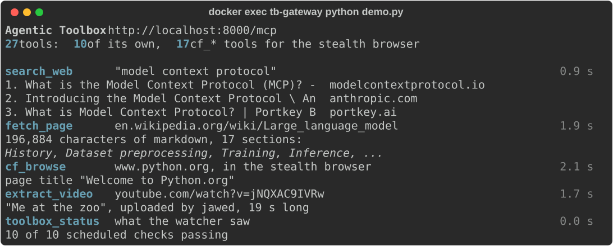

# Agentic Toolbox

A self-hosted MCP server that gives your AI agents 27 tools behind one URL: web
search, page reading, a stealth browser, document and PDF conversion, video
metadata and downloads, speech-to-text and text-to-speech. One Docker Compose
command, no accounts, no API keys.

<p align="center">
  
</p>

<sub>Real output of [`gateway/demo.py`](gateway/demo.py) on a fresh install.</sub>

## Highlights

- **One URL for every agent.** Claude Code, your own agents and any other MCP client
  share the same endpoint. Add a tool once and every agent has it.
- **Works on your network too.** Agents can read the services on your own network,
  such as a dashboard, a router page or a NAS, with the same tools they use for the
  web.
- **Private by design.** No logs, and nothing an agent asks for or gets back is
  written to disk.
- **Health checks built in.** A watcher runs a real job with every tool on a
  schedule, and `toolbox_status` shows which tools are up. If a tool is down, its
  error tells the agent since when and which tool to use instead.
- **Same build every time.** Images and packages are pinned to exact versions and
  checked when the toolbox is built, and every model is pinned to one version.

## Tools

| Your agent wants to | Tool | Runs on |
|---|---|---|
| Search the web | `search_web` | [SearXNG](https://github.com/searxng/searxng) |
| Read a page, JavaScript included | `fetch_page` | [Crawl4AI](https://github.com/unclecode/crawl4ai) |
| Get past bot protection, click, fill forms, take screenshots | `cf_browse` and 16 more `cf_*` tools | [Camoufox](https://github.com/daijro/camoufox), a stealth Firefox, through [camoufox-mcp](https://github.com/whit3rabbit/camoufox-mcp) |
| Turn a Word, PowerPoint, Excel, HTML or EPUB file into markdown | `convert_document` | [MarkItDown](https://github.com/microsoft/markitdown) |
| Get the text out of a PDF, with table rows kept together | `pdf_extract_text` | [Stirling-PDF](https://github.com/Stirling-Tools/Stirling-PDF) |
| Get a video's title, description and captions | `extract_video` | [yt-dlp](https://github.com/yt-dlp/yt-dlp) |
| Download the audio or video file itself | `download_media` | yt-dlp |
| Transcribe speech | `transcribe_audio` | [whisper.cpp](https://github.com/ggml-org/whisper.cpp), on the CPU or an AMD GPU |
| Turn text into speech, or speak in a voice cloned from a short clip | `synthesize_speech` | [OmniVoice](https://github.com/k2-fsa/OmniVoice), on the CPU |
| See which tools are up | `toolbox_status`, `ping` | the built-in watcher |

The video tools work with YouTube and every other site yt-dlp supports.

## Install

**You need** an x86-64 machine with Docker and Docker Compose v2 (Linux, or Windows
through WSL 2), 55 GB of free disk and 8 GB of RAM. No GPU needed.

```bash
git clone https://github.com/Ruashots/agentic-toolbox-mcp.git
cd agentic-toolbox-mcp
docker compose up -d --build
```

The first build downloads about 5.5 GB; on a 32-thread machine it takes about 5
minutes. Two minutes after it finishes, run the demo:

```bash
docker exec tb-gateway python demo.py
```

The first transcription and the first speech request also download their models
(from 148 MB to 3 GB). Models are kept in Docker volumes.

### Connect your agent

The endpoint is `http://<this-machine>:8000/mcp` (streamable HTTP). For Claude Code:

```bash
claude mcp add --transport http --scope user toolbox http://<this-machine>:8000/mcp
```

The tools then appear in new sessions as `mcp__toolbox__*`. For any other MCP
client, add a streamable HTTP server with the same URL.

[AGENT_HANDOFF.md](AGENT_HANDOFF.md) is a guide written for the agents themselves:
which tool to use when, ready-made workflows, and how to connect.

## Configuration

Everything works with the defaults. Optional settings:

- **AMD GPU for transcription.** Copy `.env.example` to `.env` and uncomment the
  `COMPOSE_FILE` line (details in [docker-compose.amd-gpu.yml](docker-compose.amd-gpu.yml)).
- **Only this machine.** Change `"8000:8000"` to `"127.0.0.1:8000:8000"` in
  `docker-compose.yml`.
- **Stirling-PDF's web page.** Port 8085 serves Stirling-PDF's own interface. The
  toolbox does not need it; delete the two `ports` lines under `stirling-pdf` to
  close it.
- **Browser-based MCP clients.** Requests from web pages are refused. To allow a
  client you trust, add its origin to the gateway's environment, for example
  `- FASTMCP_HTTP_ALLOWED_ORIGINS=["http://localhost:6274"]`.
- **Offline browser install.** Put the Camoufox release zip in `gateway/vendor/` and
  the build uses it instead of downloading it; see [gateway/vendor/README.md](gateway/vendor/README.md).

## Security and privacy

There is no login: anyone who can reach port 8000 can use every tool. Run it on a
network you trust, and do not expose it to the internet.

- **Network access.** Tools open any address an agent gives them, on the internet or
  on your network. Pages loaded in the toolbox's browsers cannot read other sites,
  and a page from the internet cannot make the stealth browser reach your network.
  The stealth browser does not open `localhost`.
- **No records.** Container logs are off. Files, downloads and browser data live in
  RAM and disappear on restart. Both browsers start empty on every call; a
  multi-step browser session keeps its state until it closes.
- **What leaves your machine** is what agents ask for (searches and the pages and
  files they fetch), the watcher's small test jobs, model downloads, and the normal
  start-up traffic of the browser and search engine.

The full list is in [docs/operations.md](docs/operations.md#privacy-details).

## Limits

- **x86-64 only.** ARM machines, including Apple Silicon Macs, are not supported.
- **Speech runs on the CPU** and takes about 3 to 5 times as long as the audio it
  makes. Good for narration, not for live conversation.
- **One browser page at a time.** Other browser calls wait up to 30 seconds, and an
  open multi-step session holds the browser until it closes.
- **Search depends on the engines** SearXNG asks. Results vary, and `search_web`
  says so when every engine refuses.
- **No OCR.** Scanned pages and images come back without text.
- **Downloads are returned in the response**, as base64, up to 25 MB unless the agent
  raises `max_mb`.

## Documentation

- [AGENT_HANDOFF.md](AGENT_HANDOFF.md): the guide for agents.
- [docs/operations.md](docs/operations.md): how it fits together, health checks,
  everyday commands, pinned versions and updates, debugging, privacy details, and
  adding a tool.

## Built on

[FastMCP](https://github.com/PrefectHQ/fastmcp), [SearXNG](https://github.com/searxng/searxng),
[Crawl4AI](https://github.com/unclecode/crawl4ai), [Camoufox](https://github.com/daijro/camoufox),
[camoufox-mcp](https://github.com/whit3rabbit/camoufox-mcp),
[camoufox-js](https://github.com/apify/camoufox-js),
[uBlock Origin](https://github.com/gorhill/uBlock),
[MarkItDown](https://github.com/microsoft/markitdown),
[Stirling-PDF](https://github.com/Stirling-Tools/Stirling-PDF),
[yt-dlp](https://github.com/yt-dlp/yt-dlp), [whisper.cpp](https://github.com/ggml-org/whisper.cpp)
and [OmniVoice](https://github.com/k2-fsa/OmniVoice). The browser's GeoIP data is
GeoLite2 by [MaxMind](https://www.maxmind.com). Each keeps its own license; the
build downloads them, and this repository does not include their code.

## License

MIT. See [LICENSE](LICENSE).
